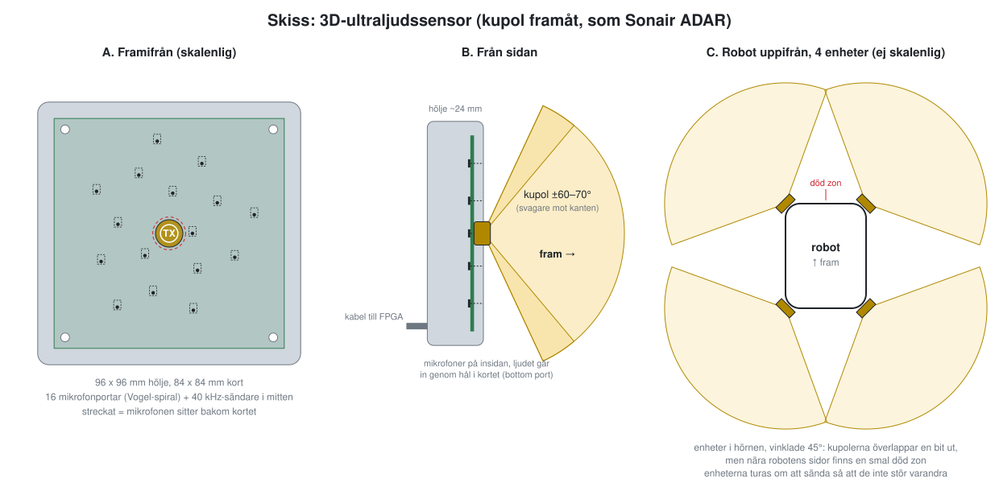

# ultrasonic-array

Egenbyggd 3D-ultraljudssensor för min robot: en 40 kHz-sändare och en array med
16 digitala MEMS-mikrofoner (PDM). Riktning och avstånd till hinder bestäms med
chirp, matchat filter och beamforming. Idén liknar Sonairs ADAR: ett platt kort
som ser i 3D (riktning + avstånd) inom en kupol framför sig. Se [docs/notes.md](docs/notes.md).

> **Lärprojekt.** Det här är ingen certifierad säkerhetsfunktion och ska inte
> användas som enda skydd mot kollisioner.



*Skiss: enheten framifrån (skalenlig), från sidan med synfältet, och fyra enheter
runt en robot. Genereras av `tools/draw_sketch.py` från `hardware/mic_placement.csv`.*

## Arkitektur

```
 40 kHz-givare ◄── drivare (TC4427A, 10-12 V) ◄── TX ─┐
                                                      │
 16 x SPH0641LU4H-1 ── 8 x DATA + 1 x CLK ──► FPGA (Boolean Board, Spartan-7)
   (Vogel-spiral, 84x84 mm)                    │  klockgenerering, PDM-inläsning,
                                               │  CIC-decimering
                                               ▼
                                         Raspberry Pi
                                           beamforming, loggning, (ROS 2)
```

- **Mikrofoner:** Knowles SPH0641LU4H-1, PDM med ultraljudsläge. Två mikrofoner delar
  en DATA-linje (SELECT väljer klockflank). 16 mikrofoner blir 8 DATA-linjer + 1 delad CLK.
- **Sändare:** Murata MA40S4S (not for new designs, ersättare ska väljas) och drivare
  med 10-12 V. Sitter i mitten av arrayen.
- **FPGA:** Real Digital Boolean Board (XC7S50, `xc7s50csga324-1`), VHDL i Vivado.
  Spartan-7 har ingen DFSDM-hårdvara, så PDM läses och decimeras i logiken.
- **Raspberry Pi:** SPI-master. Startar en ping, läser inspelningen (16 kanaler x 2048 sampel)
  och kör matchat filter och beamforming. Se [docs/pipeline.md](docs/pipeline.md).

## Status

Ärligt läge, oktober 2026:

| Del | Status |
|---|---|
| Steg 1: färdig HC-SR04-modul avläst med STM32 | ✅ Fungerar (utanför detta repo) |
| PDM-mikrofonerna (SPH0641LU4H-1) | ❌ Inte testade i hårdvara än |
| Steg 3: eget kort, 16 mikrofoner | 🚧 Utkast. Placering klar och reproducerbar från skript, designkontroller (DRC + egna) går igenom, footprints är platshållare, inga ledningar, inget jordplan, ingen sändare |
| `fpga/`: hela kedjan (klocka, 16 kanaler, CIC, chirp, inspelning, SPI till Pi) | 🧪 Simulerad i xsim, bitexakt mot Python-modellen, syntetiserad med timing uppfylld. **Otestad i hårdvara** |
| `fpga/constraints/`: pinnar | 🧪 Valda på PMOD JA/JB/JC, utlästa ur schemat, ska verifieras |
| `software/`: delay-and-sum offline | 🧪 Testad på syntetisk data, **aldrig körd på riktig mätdata** |
| `software/`: SPI-klient för Pi:n, matchat filter, Python-modell av PDM/CIC | 🧪 Testad mot en falsk FPGA och i simuleringen av hela kedjan |
| `software/`: ROS 2 | ❌ Inte påbörjat |

Alla tekniska fakta om mikrofonen och Boolean Board (pinnar, klockintervall,
tidsparametrar) ska verifieras mot datablad. Se [docs/datasheets.md](docs/datasheets.md).

## Repo-struktur

```
hardware/    KiCad-kort, footprints och genereringsskript (CERN-OHL-P)
fpga/        VHDL-källor, testbänkar, constraints
software/    Python: inläsning av loggdata och beamforming
docs/        datablad-länkar, anteckningar, bilder
tools/       hjälpskript
```

## Bygga och köra

### FPGA-simulering

Kräver Vivado 2026.1 (xsim). Se [fpga/README.md](fpga/README.md).

```bash
fpga/sim/run_xsim.sh
```

### Python

```bash
cd software
python -m venv .venv && source .venv/bin/activate
pip install -r requirements.txt
pytest
python -m beamforming data.npz --mics ../hardware/mic_placement.csv --range 1.0
python -m sonar --fake --out /tmp/x.npz --mics ../hardware/mic_placement.csv  # avstånd + riktning
```

### Kortet

Öppna `hardware/kicad/mic_array.kicad_pcb` i KiCad 10. Designkontroller (KiCads DRC
plus egna kontroller):

```bash
pytest hardware/tests
```

Se [hardware/README.md](hardware/README.md).

## TODO

Öppna punkter finns som [GitHub Issues](https://github.com/willevic2002/ultrasonic-array/issues) (översikt i [TODO.md](TODO.md)). Ändringar loggas i [CHANGELOG.md](CHANGELOG.md).

## Licens

- Kod (`fpga/`, `software/`, `tools/`): [MIT](LICENSE)
- Hårdvara (`hardware/`): [CERN-OHL-P-2.0](hardware/LICENSE)
